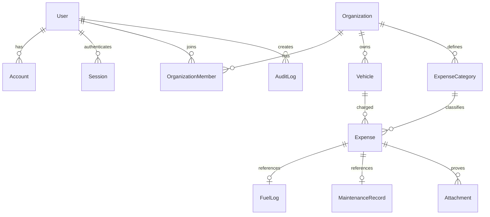

# ERD và quy tắc số liệu (P0-05, P0-07)

Chính sách dữ liệu: unique `(provider,providerAccountId)`, `(organizationId,userId)`, `(organizationId,normalizedPlate)`, `(organizationId,idempotencyKey)`. Index expense theo `(organizationId,occurredAt,status)`, `(organizationId,vehicleId,occurredAt)`, `(organizationId,categoryId,occurredAt)`. DB tiền `DECIMAL(18,0)`; thời điểm `TIMESTAMPTZ`; `createdAt` tách ngày phát sinh. Guard và database transaction kiểm xe và expense cùng tenant.

`SUM(expenses.amount WHERE status=POSTED)` là tổng duy nhất trong tổ chức và khoảng UTC tương ứng `Asia/Ho_Chi_Minh`; VOID không tính. Lít và kWh khác đơn vị; 0/thiếu km hoặc chu kỳ không hợp lệ hiển thị “Chưa đủ dữ liệu”. GĐ3–GĐ4 bổ sung schema và migration riêng theo thứ tự kế hoạch.
